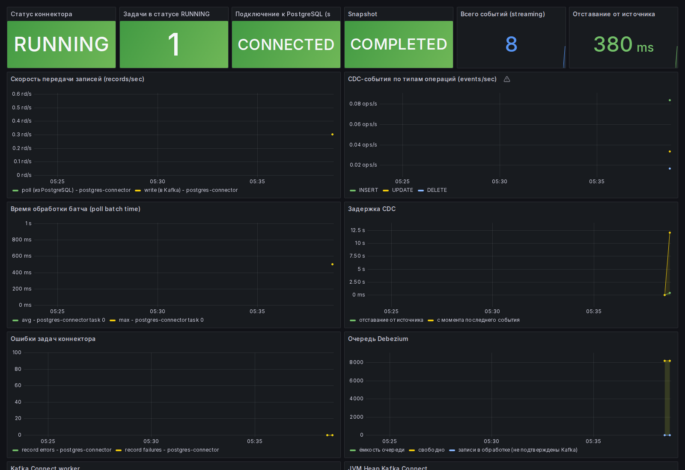

# Подтверждение реального запуска

Проверен коммит `ded724042005bcbe063fd64b1b4b199c09d598da`.

Запуск: https://github.com/SVFr13nD/kafka-practicum-4/actions/runs/43811394998

- Коннектор и все задачи: RUNNING — [JSON](connector-status.json).
- Snapshot, INSERT, UPDATE, DELETE, tombstone из двух топиков — [вывод consumer](consumer-output.txt).
- Выполнение test-data.sql — [вывод PostgreSQL](test-data-output.txt).
- Непустые метрики — [ответы Prometheus](prometheus-queries.json).

